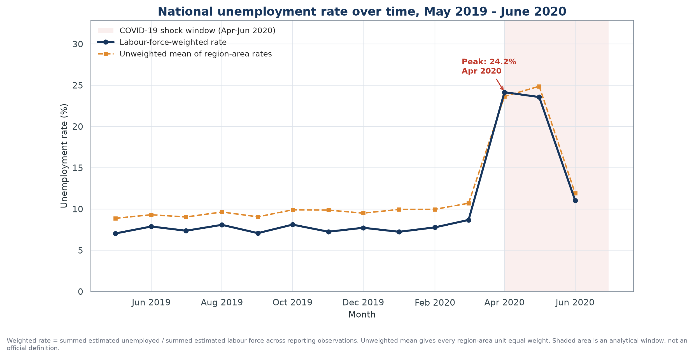
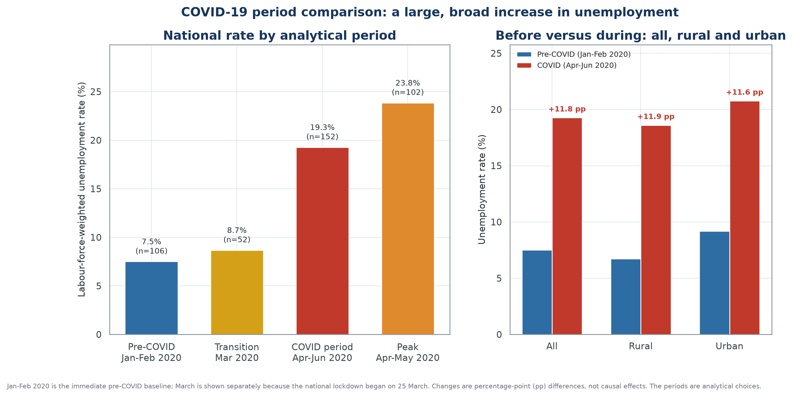
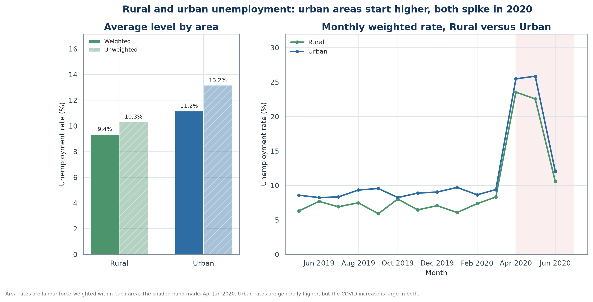
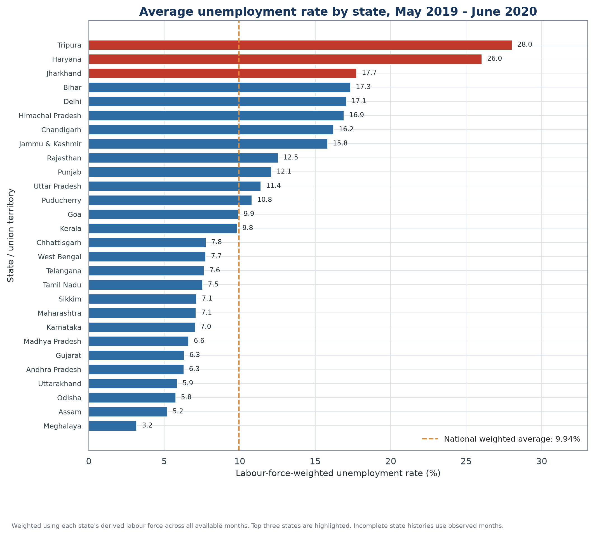

# Unemployment Analysis with Python

**CodeAlpha Data Science Internship — Task 2**

A reproducible analysis of monthly unemployment estimates for Indian states and union
territories, with a focused study of the labour-market shock around April–June 2020.
The project covers raw-data inspection, cleaning, exploratory analysis, COVID-19 impact
and recovery analysis, a fully executed Jupyter notebook, fourteen publication-quality
charts, and a 23-page PDF report.

> This is an independent analytical exercise. It is not an official statistical
> publication, and it does not claim that COVID-19 was the sole cause of every observed
> change.

---

## Table of contents

1. [What this project answers](#what-this-project-answers)
2. [Datasets](#datasets)
3. [Project structure](#project-structure)
4. [Methodology](#methodology)
5. [Key findings](#key-findings)
6. [Visualisations](#visualisations)
7. [Project Visualizations](#project-visualizations)
8. [Deliverables](#deliverables)
9. [Reproducing the analysis](#reproducing-the-analysis)
10. [Notebook](#notebook)
11. [Report](#report)
12. [Limitations](#limitations)
13. [Data quality summary](#data-quality-summary)
14. [Tools and versions](#tools-and-versions)
15. [Project author](#project-author)

---

## What this project answers

- What did national unemployment look like between May 2019 and October 2020?
- How different are states and union territories, and when did each experience its peak?
- How did Rural and Urban labour markets differ before and during the COVID-19 period?
- How large was the employment loss, and how complete was the recovery by June 2020?
- Which states and geographic zones were hit hardest?
- Are the patterns consistent across the two supplied datasets?
- Is there enough evidence to claim seasonality?
- What policy responses follow from the observed patterns?

The analysis is deliberately descriptive. It separates **observed changes** from
**causal explanations** and states where the data cannot decide between competing
interpretations.

---

## Datasets

Both files were supplied for the CodeAlpha Task 2 exercise. The originals are preserved
unchanged in `data/`; cleaning writes new files and never overwrites the raw data.

| # | File | Role | Coverage | Rows | Regions |
|---|------|------|----------|------|---------|
| 1 | `data/Unemployment in India.csv` | Primary | May 2019 – Jun 2020 (14 months) | 740 valid | 28 |
| 2 | `data/Unemployment_Rate_upto_11_2020.csv` | Supplementary | Jan 2020 – Oct 2020 (10 months) | 267 | 27 |

### Source and attribution

Both CSV files were supplied as part of the **CodeAlpha Data Science Internship — Task 2**
and are used here for that internship exercise. No original publisher URL or licence
metadata is recorded in the supplied files or the project metadata, so no external source
URL is asserted. The raw files are preserved byte-for-byte in `data/`, and all derived
outputs are generated from those copies.

Dataset 1 has Rural and Urban rows and is the basis for the main analysis. Dataset 2
adds a longer 2020 recovery window and a geographic `Zone` column, but its filename says
“upto 11/2020” while the last actual observation is **31 October 2020**. The analysis uses
the dates that are present, not the filename.

The two datasets are analysed **separately**. They overlap on 158 state-month cells, which
are compared as a validation exercise but are never concatenated or blindly merged.

Both files report estimates of the unemployment rate, estimated employed people, and the
labour participation rate. The data dictionary is in
`outputs/cleaned_data/data_dictionary.md`.

---

## Project structure

```text
CodeAlpha_Unemployment_Analysis/
├── data/
│   ├── Unemployment in India.csv            # original, untouched
│   └── Unemployment_Rate_upto_11_2020.csv   # original, untouched
├── notebooks/
│   └── unemployment_analysis.ipynb          # executed, 55 cells
├── src/
│   ├── utils.py                             # paths, cleaning, weighted metrics, theme
│   ├── charts.py                            # all chart functions
│   ├── 01_dataset_inspection.py             # raw-data audit
│   ├── 02_data_cleaning.py                  # cleaning + quality report
│   ├── 03_exploratory_analysis.py           # EDA tables and summary JSON
│   ├── 04_data_visualization.py             # EDA charts 01–10
│   ├── 05_covid_impact_analysis.py          # COVID analysis + charts 11–14
│   ├── 06_generate_report.py                # ReportLab PDF builder
│   └── 07_build_notebook.py                 # builds the narrative notebook
├── outputs/
│   ├── inspection/                          # raw audit text + JSON
│   ├── cleaned_data/                        # cleaned CSVs, log, dictionary, QA
│   ├── analysis/                            # tables and summary JSON
│   └── charts/                              # 14 PNGs at 200 dpi
├── report/
│   └── Unemployment_Analysis_Report.pdf     # 23 pages, 14 figures
├── README.md
├── requirements.txt
└── .gitignore
```

Intermediate QA artefacts (rendered PDF pages, TOC debug output) are intentionally not
part of the deliverable set.

---

## Methodology

### Cleaning

- Column headers are normalised to `snake_case`; dates are parsed to real dates.
- Dataset 1 contains **28 fully blank rows**, which are removed. No value is imputed.
- `Frequency` is standardised to `Monthly`; month keys and a derived `period` column are
  added.
- Exact 0% unemployment observations are **retained and flagged**, not treated as errors.
- Statistical outliers are **retained**. They are real high-unemployment observations and
  removing them would understate the shock being studied.
- Dataset 2's `Zone` and centroid coordinates are preserved for geographic analysis.

### Weighted headline rate

State sizes differ by orders of magnitude, so a simple average of state rates would let
small union territories dominate. The headline rate is therefore labour-force weighted:

```text
estimated_labour_force = estimated_employed / (1 - unemployment_rate / 100)
estimated_unemployed   = estimated_labour_force - estimated_employed
weighted_rate          = 100 × Σ(estimated_unemployed) / Σ(estimated_labour_force)
```

This is an analytical approximation built from the supplied estimates. It is **not** a new
official estimate: the source does not provide population weights or survey design
details. Unweighted means and medians are reported alongside the weighted rate, and all
three are labelled explicitly.

### Period definitions

| Period | Definition |
|--------|------------|
| Pre-COVID | Before 1 March 2020 |
| Transition | March 2020 |
| COVID period | April 2020 onward |
| Baseline | January–February 2020 average |
| Shock window | April–June 2020 |
| Peak | April–May 2020 |

April is treated as the peak month because that is what the data show; the analysis does
not assume it in advance.

### Employment panel

Employment totals are computed on a **balanced panel of 20 states** that have all 14
months and both Rural and Urban rows. Holding sample composition constant prevents the
apparent employment change from being driven by which states reported in which month.
The panel is an analytical construct, not a national employment count.

### Comparison and causality

Observed differences are reported as percentage-point (pp) changes for rates and
percentage changes for levels. The report explicitly distinguishes:

- what changed,
- when it changed,
- how large the change was,
- and what cannot be concluded from a short observational panel.

---

## Key findings

### National level

- Weighted unemployment over the full primary dataset was **9.94%**; the unweighted mean
  was **11.79%** and the median **8.35%**. The mean sits above the median because the
  distribution has a long right tail.
- Pre-COVID monthly weighted rates stayed in a narrow **7.04–8.11%** band.
- March 2020 was **8.68%**; April surged to **24.16%** and May to **23.57%**; June fell
  back to **11.04%**.
- Against the January–February baseline of **7.51%**, the April–June average of **19.28%**
  was **+11.77 pp (+156.8%)**. The April–May peak average of **23.85%** was
  **+16.34 pp (+217.7%)**.

### Employment and participation

- In the balanced 20-state panel, employment fell from **384.5 million** in
  January–February to **263.5 million** in April: **−121.0 million (−31.5%)**.
- May was **27.0%** below baseline and June **8.0%** below. Recovery was substantial but
  incomplete by the end of the primary dataset.
- Urban employment fell slightly more in April (**−34.7%**) than rural (**−30.0%**).
- Average labour participation fell **5.84 pp**, from 43.89% to 38.05% in April–June.
  Some of this is consistent with discouraged workers leaving the labour force, but the
  data cannot separate that from other reasons for non-participation.

### Rural and urban

| Area | Weighted average | Jan–Feb 2020 | Apr–Jun 2020 | Change | LPR change |
|------|------------------|--------------|--------------|--------|------------|
| Rural | 9.36% | 6.72% | 18.61% | +11.89 pp | −5.18 pp |
| Urban | 11.18% | 9.19% | 20.77% | +11.58 pp | −6.50 pp |

Urban unemployment was higher in level, but the absolute COVID-period increase was almost
identical in the two areas. Because rural unemployment started lower, its **relative**
increase was larger (+176.9% vs +126.1%).

### States and zones

- **23 of 27 regions** with a usable baseline saw unemployment rise from January–February
  to April–June 2020.
- Largest increases: **Puducherry +56.73 pp** (from a very low 1.20% baseline, and highly
  volatile), **Jharkhand +30.67 pp**, **Tamil Nadu +29.79 pp**, **Bihar +27.11 pp**,
  **Karnataka +16.19 pp**, **Kerala +15.38 pp**.
- Four regions fell: Tripura −4.57 pp, Jammu & Kashmir −10.27 pp, Chandigarh −11.19 pp,
  Himachal Pradesh −3.90 pp. Sikkim has no usable baseline.
- Highest full-period averages: Tripura 28.04%, Haryana 26.04%, Jharkhand 17.74%, Bihar
  17.34%, Delhi 17.05%.
- Lowest full-period averages: Meghalaya 3.17%, Assam 5.20%, Odisha 5.75%, Uttarakhand
  5.86%, Andhra Pradesh 6.29%.
- Zone averages: East 13.59%, North 13.46%, South 8.54%, Northeast 7.29%, West 7.05%.
  COVID-period increases were largest in the East (+17.63 pp) and South (+14.35 pp),
  and smallest in the Northeast (+1.78 pp).

### Supplementary dataset and validation

- Dataset 2 shows the same shock shape: **7.22% in January → 23.95% in April → 7.01% in
  October 2020**.
- For the same 26 states, the rate was **−0.21 pp** lower in October than in January, but
  employment was still **−3.23% (−13.15 million)** below the January level and labour
  participation was **−3.21 pp** lower. A recovered unemployment rate therefore does not
  mean a fully recovered labour market.
- On the 158 overlapping state-month cells, the two datasets correlate at **r = 0.972**,
  with a mean difference of **0.253 pp** and a mean absolute difference of **1.04 pp**.
  The datasets are broadly consistent, but the differences may reflect revisions or
  differences in estimation and reporting. Their exact cause cannot be established from
  the supplied files.

### Seasonality

There is **insufficient evidence** to claim a seasonal cycle. The primary dataset spans
only 14 months, and the only repeated calendar months (May and June) are observed once
before and once during the pandemic, so the comparison is COVID-confounded. Dataset 2
covers a single calendar year. The report says so explicitly rather than fitting a
seasonal model to two years of partial coverage.

---

## Visualisations

All charts are saved at **200 dpi** in `outputs/charts/`, with titles, axis labels, units,
and legends where relevant.

| # | File | What it shows |
|---|------|---------------|
| 01 | `01_overall_unemployment_trend.png` | Weighted and unweighted national trend, May 2019 – Jun 2020 |
| 02 | `02_state_unemployment_bar.png` | Average unemployment by state and union territory |
| 03 | `03_rural_urban_comparison.png` | Rural vs urban levels and monthly paths |
| 04 | `04_monthly_unemployment_dispersion.png` | Monthly medians and cross-region interquartile range |
| 05 | `05_correlation_heatmap.png` | Correlation among unemployment, employment, participation |
| 06 | `06_unemployment_distribution.png` | Distribution of observation-level unemployment rates |
| 07 | `07_unemployment_boxplot.png` | Box plots by area and by COVID-19 period |
| 08 | `08_state_month_heatmap.png` | State × month timing of peaks and unreported cells |
| 09 | `09_employment_trend.png` | Balanced-panel employment and area index |
| 10 | `10_labour_participation_trend.png` | Participation over time, rural/urban/national |
| 11 | `11_covid_period_comparison.png` | Pre-COVID vs transition vs COVID-period distributions |
| 12 | `12_covid_state_increases.png` | State-level change from baseline to April–June |
| 13 | `13_extended_recovery_d2.png` | Dataset 2 recovery path through October 2020 |
| 14 | `14_zone_unemployment.png` | Zone-level averages and COVID-period increases |

Charts 09 and 10 use a balanced panel and an approximated national participation series;
the captions state these derivations rather than presenting them as official totals.

---

## Project Visualizations

Four existing charts from `outputs/charts/` are reproduced below. They cover the national
trend, the COVID-19 impact, the Rural–Urban comparison, and the state-wise comparison.

### Monthly unemployment trend



*Weighted and unweighted national unemployment, May 2019 – June 2020.*

### COVID-19 impact



*Unemployment distributions before, during the transition, and during the COVID-19 period.*

### Rural vs Urban comparison



*Rural and urban unemployment levels and monthly paths.*

### State-wise unemployment comparison



*Average labour-force-weighted unemployment by state and union territory.*

---

## Deliverables

| Deliverable | Location |
|-------------|----------|
| Executed notebook | `notebooks/unemployment_analysis.ipynb` |
| PDF report | `report/Unemployment_Analysis_Report.pdf` |
| Cleaned data | `outputs/cleaned_data/` |
| Data-quality report | `outputs/cleaned_data/data_quality_report.csv` |
| Cleaning log | `outputs/cleaned_data/cleaning_log.json` |
| EDA tables | `outputs/analysis/` |
| COVID analysis tables | `outputs/analysis/covid_*.csv` and `covid_summary.json` |
| Charts | `outputs/charts/` (14 PNGs) |
| Raw inspection | `outputs/inspection/` |

The notebook is executed in place, so all tables and figures are visible without running
anything. The PDF embeds all fourteen charts and reports the same numbers as the notebook
and the JSON summaries.

---

## Reproducing the analysis

### 1. Create an environment

PowerShell on Windows:

```powershell
python -m venv .venv
.\.venv\Scripts\Activate.ps1
python -m pip install --upgrade pip
pip install -r requirements.txt
```

macOS/Linux:

```bash
python3 -m venv .venv
source .venv/bin/activate
pip install -r requirements.txt
```

### 2. Run the pipeline from the project root

```powershell
python src/01_dataset_inspection.py
python src/02_data_cleaning.py
python src/03_exploratory_analysis.py
python src/04_data_visualization.py
python src/05_covid_impact_analysis.py
python src/07_build_notebook.py
python -m nbconvert --to notebook --execute --inplace notebooks/unemployment_analysis.ipynb
python src/06_generate_report.py
```

Each script resolves paths relative to the project root, so it can also be run from
another directory with an absolute path. The notebook builder is run before the report so
the notebook and PDF are generated from the same outputs.

Expected runtime is a few minutes on a normal laptop; most of the time is chart rendering
and notebook execution.

### 3. Check the outputs

- 14 PNGs in `outputs/charts/`
- 15/15 passing checks in `outputs/cleaned_data/data_quality_report.csv`
- non-empty `outputs/analysis/eda_summary.json` and `covid_summary.json`
- a 23-page `report/Unemployment_Analysis_Report.pdf`
- a notebook with no error outputs

---

## Notebook

`notebooks/unemployment_analysis.ipynb` is the narrative version of the project. It has
**55 cells (20 code, 35 Markdown)** and is executed in place, producing **28 embedded
images** across the EDA and COVID sections. It follows the same order as the scripts:
inspection → cleaning → EDA → visualisation → COVID analysis → validation → policy.

The notebook is generated by `src/07_build_notebook.py` from the analysis outputs, then
executed with `nbconvert`. If you edit the analysis scripts, rerun both steps so the
narrative numbers and the report stay in sync.

---

## Report

`report/Unemployment_Analysis_Report.pdf` is an A4 ReportLab document with:

- a cover page,
- a detailed table of contents,
- an executive summary,
- eight sections covering introduction, data and methodology, data quality, exploratory
  analysis, COVID-19 impact, validation and seasonality, policy recommendations, and
  conclusion,
- appendices with reproducibility commands, a data dictionary, and method notes,
- all 14 charts, tables, and callouts.

Page numbers, cross-references, and figure numbers are generated by the document builder.
The report is intentionally written for a general audience while keeping the measurement
caveats explicit.

---

## Limitations

1. **Observational data.** The analysis describes changes around the pandemic period; it
   cannot isolate COVID-19 from other simultaneous shocks or policy responses.
2. **Short panel.** Fourteen months (primary) and ten months (supplementary) are not enough
   for a credible seasonal decomposition.
3. **No population or survey-design weights.** The weighted rate is derived from the
   supplied employed and rate estimates. It improves on a simple average of states but is
   not a design-consistent national estimate.
4. **Incomplete coverage.** The primary dataset is missing 44 region-area-month cells out
   of 784 expected combinations (5.6%). Missing cells are not imputed. Twenty states have
   complete coverage and form the balanced employment panel.
5. **Zero and extreme values.** Eleven exact 0% observations and 35 high outliers are kept.
   They are flagged and discussed; deleting them would bias the distribution and the
   shock estimate.
6. **Reporting revisions.** The two datasets differ slightly on overlapping cells. The
   validation section quantifies this rather than forcing the files to agree.
7. **Filename mismatch.** Dataset 2 is named “upto 11/2020” but ends on 31 October 2020.
   Actual dates are used throughout.
8. **Area comparisons.** Rural and urban participation figures are simple means; the
   national participation line is an approximation because population counts are not
   supplied.

---

## Data quality summary

The cleaning phase runs **15 checks**, all of which pass:

- valid date parsing and month coverage,
- unique region-area-month keys,
- rates within 0–100,
- non-negative employment and participation,
- labour-force arithmetic consistency,
- expected category sets for area, zone, and period,
- no duplicate rows,
- documented missingness,
- row-count reconciliation against the raw files.

The full check table is in `outputs/cleaned_data/data_quality_report.csv`; every cleaning
decision and its rationale is recorded in `outputs/cleaned_data/cleaning_log.json`.

Primary dataset after cleaning: **740 rows, 28 regions, 14 months, 2 areas**. Supplementary
dataset: **267 rows, 27 regions, 10 months, 5 zones**.

---

## Tools and versions

The project was built and validated with:

- Python 3.13.2
- pandas 3.0.5
- NumPy 2.5.3
- Matplotlib 3.11.2
- seaborn 0.13.2
- Pillow 12.3.0
- ReportLab 5.1.0
- nbformat 5.11.1
- nbconvert 7.17.2
- ipykernel 7.3.0
- jupyter-client 8.10.0

Exact versions are pinned in `requirements.txt`.

---

## Project author

- **Project:** Unemployment Analysis with Python
- **Internship:** CodeAlpha Data Science Internship
- **Task:** Task 2
- **Author:** PALAGANI DATTU NAGA VENKATA ARAVIND
- **GitHub Repository:** https://github.com/aravindpalagani/CodeAlpha_Unemployment_Analysis

Prepared as **CodeAlpha Data Science Internship — Task 2: Unemployment Analysis with
Python**. The repository is self-contained: raw data, code, outputs, notebook, and report
are all included. No external data or invented statistics are used.
